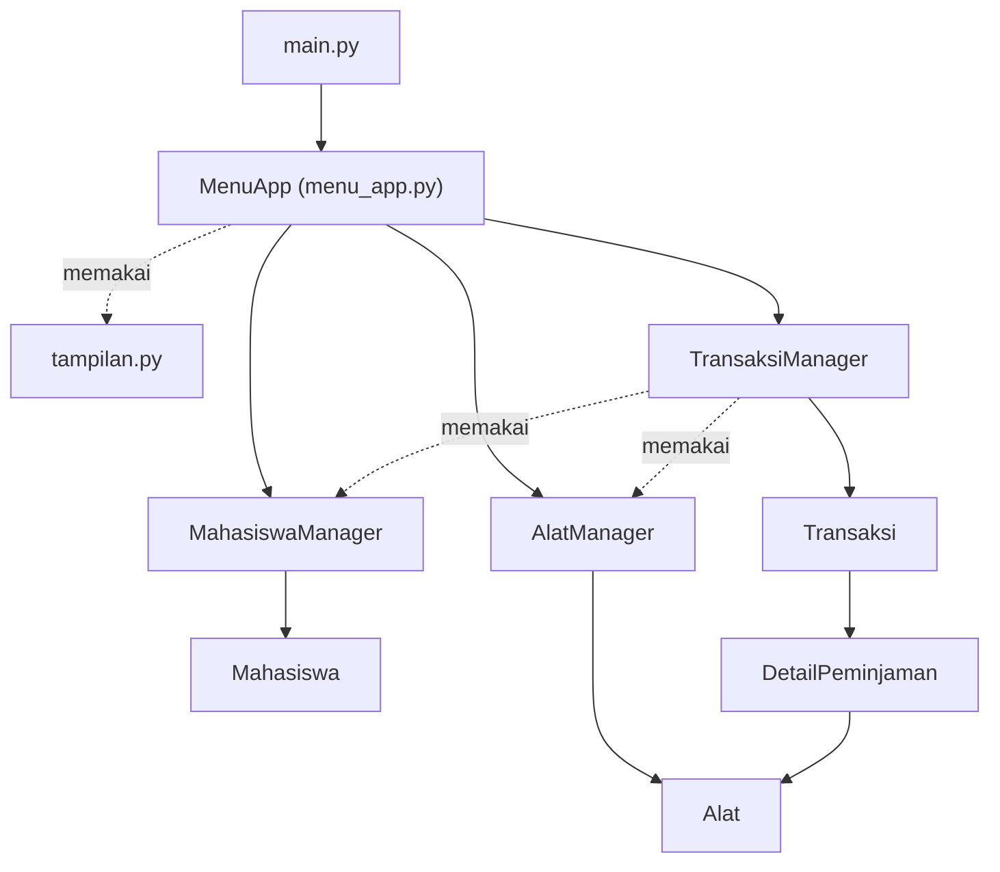

<div align="center">

# 🔬 Sistem Peminjaman Peralatan Laboratorium

**Aplikasi terminal berbasis Python OOP untuk mencatat peminjaman alat laboratorium oleh mahasiswa.**


</div>

---

## 📌 Daftar Isi

1. [Nama Aplikasi](#-nama-aplikasi)
2. [Anggota Kelompok](#-anggota-kelompok)
3. [Deskripsi Sistem](#-deskripsi-sistem)
4. [Struktur Program](#-struktur-program)
5. [Cara Menjalankan](#-cara-menjalankan)
6. [Pembagian Kontribusi](#-pembagian-kontribusi)

---

## 🧪 Nama Aplikasi

**Sistem Peminjaman Peralatan Laboratorium**

Aplikasi ini dibuat dengan Python dan dijalankan lewat terminal. Data disimpan sementara di memori (`dict` dan `list`), **tanpa database**.

---

## 👥 Anggota Kelompok

**Kelompok 3**

| No | Nama | NIM | Akun GitHub |
|:--:|------|-----|-------------|
| 1 | Farrel Muflif Muzzaki | K3525024 | [@relzajaa](https://github.com/relzajaa) |
| 2 | Gisma Dian Utami | K3525026 | [@gismadian](https://github.com/gismadian) |
| 3 | Nourin Akbar Pratama | K3525067 | [@Akbarr-11](https://github.com/Akbarr-11) |
| 4 | Azzahra Hendar Asafira | K3525081 | [@azzahrahendar](https://github.com/azzahrahendar) |

---

## 📖 Deskripsi Sistem

Sistem ini membantu petugas lab mencatat **siapa** meminjam **alat apa**, **kapan** harus kembali, dan **bagaimana kondisi** alat saat dikembalikan.

### ✨ Fitur

| Menu | Fitur | Keterangan |
|:--:|-------|------------|
| 1 | Kelola Data Mahasiswa | Tambah, edit, hapus, cari, dan lihat daftar mahasiswa |
| 2 | Kelola Data Alat | Tambah (bisa banyak unit sekaligus), edit, hapus, cari, lihat daftar, dan tambah kategori |
| 3 | Buat Transaksi Peminjaman | Satu transaksi boleh berisi beberapa alat, lama pinjam 1–7 hari |
| 4 | Tampilkan Transaksi | Semua transaksi dan detailnya, ada tanda **TERLAMBAT** |
| 5 | Proses Pengembalian Alat | Alat dikembalikan satu per satu, lengkap dengan kondisi dan tanggal |
| 6 | Cari Transaksi Berdasarkan Mahasiswa | Cari memakai NIM |
| 7 | Tampilkan Alat yang Tersedia | Daftar alat + jumlah stok |
| 8 | Tampilkan Alat yang Sedang Dipinjam | Daftar alat yang belum kembali |
| 9 | Tampilkan Alat yang Rusak | Daftar alat berkondisi rusak |
| 10 | Tampilkan Riwayat Peminjaman Mahasiswa | Transaksi yang sudah selesai, terbaru di atas |
| 11 | Keluar dari Program | Menutup aplikasi |
| 12 | 🏆 Pencarian Alat | Cari berdasarkan kode, nama, atau kategori |
| 13 | 🏆 Statistik Peminjaman | Alat terpopuler, mahasiswa teraktif, jumlah transaksi aktif dan selesai |
| 14 | 🏆 Pemeliharaan Alat | Alat rusak diperbaiki lalu kembali tersedia dalam kondisi baik |

> 🏆 = menu tantangan

### 📏 Aturan Peminjaman

1. Satu mahasiswa maksimal punya **2 transaksi aktif**.
2. Alat hanya bisa dipinjam jika statusnya **Tersedia**.
3. Satu transaksi bisa berisi **banyak alat**. Kode alat yang diketik dua kali dihitung sekali.
4. Pengembalian dicatat **per alat** (tanggal, kondisi, dan hari terlambat). Status transaksi berubah otomatis: *Dipinjam → Sebagian dikembalikan → Selesai*.
5. Alat yang kembali **Baik** langsung tersedia. Alat **rusak** menjadi *Tidak tersedia* sampai diperbaiki lewat menu Pemeliharaan.
6. Mahasiswa yang masih punya transaksi aktif dan alat yang sedang dipinjam **tidak bisa dihapus**.

### 🛡️ Pemeriksaan Input

- NIM dan kode alat tidak boleh sama dengan yang sudah ada.
- No. HP hanya angka, panjang 10–13 digit.
- Tanggal kembali berformat `DD-MM-YYYY` dan tidak boleh sebelum tanggal pinjam.
- Jika ada kesalahan, muncul pesan `[!]` berwarna merah dan program tidak berhenti.

### 🖥️ Tampilan Program

Ini tampilan menu utama saat program dijalankan (garis dan kotak berwarna kuning, tulisan berwarna putih):

<pre style="background:#0c0c0c; color:#ffffff; padding:12px; overflow-x:auto; line-height:1.3">
      <span style="color:#F5F543">╔══════════════════════════════════════════════════════════════════╗</span>
      <span style="color:#F5F543">║</span>          <span style="color:#F5F543"><b>♦</b></span><b>  SISTEM PEMINJAMAN PERALATAN LABORATORIUM  </b><span style="color:#F5F543"><b>♦</b></span>          <span style="color:#F5F543">║</span>
      <span style="color:#F5F543">╚══════════════════════════════════════════════════════════════════╝</span>

                 Hari ini: 12-10-2026   |   Transaksi aktif: 0                  

      <span style="color:#F5F543">┌──────────────────────────────────────────────────────────────────┐</span>
      <span style="color:#F5F543">│</span>                            <b>MENU UTAMA</b>                            <span style="color:#F5F543">│</span>
      <span style="color:#F5F543">╞══════════════════════════════════════════════════════════════════╡</span>
      <span style="color:#F5F543">│</span>  1. Kelola Data Mahasiswa                                        <span style="color:#F5F543">│</span>
      <span style="color:#F5F543">│</span>  2. Kelola Data Alat                                             <span style="color:#F5F543">│</span>
      <span style="color:#F5F543">│</span>  3. Buat Transaksi Peminjaman                                    <span style="color:#F5F543">│</span>
      <span style="color:#F5F543">│</span>  4. Tampilkan Transaksi                                          <span style="color:#F5F543">│</span>
      <span style="color:#F5F543">│</span>  5. Proses Pengembalian Alat                                     <span style="color:#F5F543">│</span>
      <span style="color:#F5F543">│</span>  6. Cari Transaksi Berdasarkan Mahasiswa                         <span style="color:#F5F543">│</span>
      <span style="color:#F5F543">│</span>  7. Tampilkan Alat yang Tersedia                                 <span style="color:#F5F543">│</span>
      <span style="color:#F5F543">│</span>  8. Tampilkan Alat yang Sedang Dipinjam                          <span style="color:#F5F543">│</span>
      <span style="color:#F5F543">│</span>  9. Tampilkan Alat yang Rusak                                    <span style="color:#F5F543">│</span>
      <span style="color:#F5F543">│</span> 10. Tampilkan Riwayat Peminjaman Mahasiswa                       <span style="color:#F5F543">│</span>
      <span style="color:#F5F543">│</span> 11. Keluar dari Program                                          <span style="color:#F5F543">│</span>
      <span style="color:#F5F543">└──────────────────────────────────────────────────────────────────┘</span>

      <span style="color:#F5F543">┌──────────────────────────────────────────────────────────────────┐</span>
      <span style="color:#F5F543">│</span>                          <b>MENU TANTANGAN</b>                          <span style="color:#F5F543">│</span>
      <span style="color:#F5F543">╞══════════════════════════════════════════════════════════════════╡</span>
      <span style="color:#F5F543">│</span> 12. Pencarian Alat                                               <span style="color:#F5F543">│</span>
      <span style="color:#F5F543">│</span> 13. Statistik Peminjaman                                         <span style="color:#F5F543">│</span>
      <span style="color:#F5F543">│</span> 14. Pemeliharaan Alat                                            <span style="color:#F5F543">│</span>
      <span style="color:#F5F543">└──────────────────────────────────────────────────────────────────┘</span>
      Pilih menu (1-14): 
</pre>

---

## 🗂️ Struktur Program

### Susunan Folder

```text
Sistem Peminjaman Peralatan Laboratorium/
├── main.py                    # pintu masuk program
├── README.md
└── sistem_peminjaman_lab/
    ├── __init__.py
    ├── models.py              # Enum dan class data (Domain)
    ├── managers.py            # aturan dan penyimpanan data (Manager)
    ├── menu_app.py            # menu dan alur input (UI)
    └── tampilan.py            # fungsi bantu cetak di terminal
```

### Tiga Lapisan Program



| Lapisan | File | Tugas |
|---------|------|-------|
| **UI** | `menu_app.py`, `tampilan.py` | Menampilkan menu dan tabel, membaca input, menangkap pesan error |
| **Manager** | `managers.py` | Menyimpan data di `dict` dan memeriksa aturan |
| **Domain** | `models.py` | Objek data (mahasiswa, alat, transaksi) dan pilihan tetap (Enum) |

### Class dan Enum (8 class + 3 enum)

| Jenis | Nama | Tugas |
|-------|------|-------|
| Class | `MenuApp` | Menjalankan menu 1–14 dan submenunya |
| Class | `MahasiswaManager` | Mengelola data mahasiswa (kunci = NIM) |
| Class | `AlatManager` | Mengelola data alat, kategori, dan pemeliharaan (kunci = kode alat) |
| Class | `TransaksiManager` | Membuat transaksi, memproses pengembalian, riwayat, dan statistik (kunci = ID seperti `TRX001`) |
| Class | `Mahasiswa` | Data mahasiswa dan daftar transaksi aktifnya |
| Class | `Alat` | Data alat beserta kondisi dan statusnya |
| Class | `Transaksi` | Satu peminjaman: tanggal, batas kembali, status, dan daftar alat |
| Class | `DetailPeminjaman` | Catatan satu alat di dalam transaksi |
| Enum | `StatusTransaksi` | `DIPINJAM`, `SEBAGIAN_DIKEMBALIKAN`, `SELESAI` |
| Enum | `KondisiAlat` | `BAIK`, `RUSAK_RINGAN`, `RUSAK_BERAT` |
| Enum | `StatusAlat` | `TERSEDIA`, `DIPINJAM`, `TIDAK_TERSEDIA`, `PEMELIHARAAN` |

### Struktur Data yang Dipakai

| Struktur | Dipakai untuk |
|----------|---------------|
| `dict` | Tempat menyimpan data tiap manager dan daftar menu |
| `list` | Daftar alat dalam transaksi dan hasil pencarian |
| `set` | Kategori alat dan ID transaksi aktif mahasiswa (tidak boleh ganda) |
| `tuple` | Pasangan `(nama, jumlah)` pada statistik |

---

## 🚀 Cara Menjalankan

### Yang Dibutuhkan

- **Python 3.8 atau lebih baru** (sudah dicoba di Python 3.12)
- Terminal yang bisa menampilkan warna dan karakter Unicode (Windows Terminal, PowerShell, macOS Terminal, atau terminal Linux)
- Tidak perlu `pip install` apa pun

### Langkah-langkah

```bash
# 1. Masuk ke folder proyek
cd "Sistem Peminjaman Peralatan Laboratorium"

# 2. Jalankan program
python main.py          # Windows
python3 main.py         # macOS / Linux
```

### Contoh Alur Pemakaian

Program **mulai tanpa data contoh**, jadi isi data dulu:

1. **Menu 1** → tambah mahasiswa (NIM, nama, No. HP).
2. **Menu 2** → tambah alat. Contoh: kode `MKS`, jumlah `3` → otomatis jadi `MKS-01`, `MKS-02`, `MKS-03`.
3. **Menu 3** → buat peminjaman (NIM, kode alat dipisah koma, lama pinjam).
4. **Menu 5** → kembalikan alat (pilih transaksi, kode alat, kondisi, tanggal).
5. **Menu 4, 10, 13** → lihat transaksi, riwayat, dan statistik.

> ⚠️ Data hanya tersimpan di memori, jadi **hilang saat program ditutup**.

---

## 🤝 Pembagian Kontribusi

| Anggota | File yang Dikerjakan | Isi Tugas |
|---------|----------------------|-----------|
| **Farrel Muflif Muzzaki** | `menu_app.py`, `main.py` | Menu utama dan submenu, alur input pengguna, menu tantangan, serta pintu masuk program |
| **Gisma Dian Utami** | `models.py` | Enum dan class data: `Mahasiswa`, `Alat`, `DetailPeminjaman`, `Transaksi` |
| **Nourin Akbar Pratama** | `tampilan.py` | Tampilan terminal: warna, kotak, tabel, dan pesan |
| **Azzahra Hendar Asafira** | `managers.py` | `MahasiswaManager`, `AlatManager`, `TransaksiManager`, serta pemeriksaan aturan |

---

<div align="center">

**Kelompok 3** · Dibuat dengan 🐍 Python

</div>