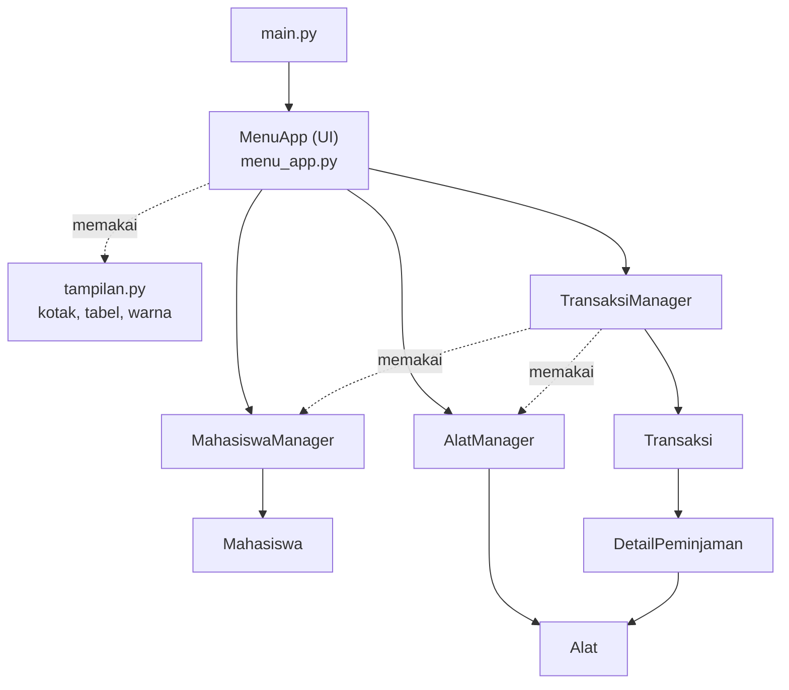

<div align="center">

# 🔬 Sistem Peminjaman Peralatan Laboratorium

**Aplikasi terminal berbasis Python OOP untuk mengelola mahasiswa, alat lab, dan transaksi peminjaman.**


</div>

---

## 📌 Daftar Isi

1. [Tentang Aplikasi](#-tentang-aplikasi)
2. [Anggota Kelompok](#-anggota-kelompok)
3. [Deskripsi Sistem](#-deskripsi-sistem)
4. [Struktur Program](#-struktur-program)
5. [Cara Menjalankan](#-cara-menjalankan)
6. [Pembagian Kontribusi](#-pembagian-kontribusi)

---

## 🧪 Tentang Aplikasi

| | |
|---|---|
| **Nama Aplikasi** | Sistem Peminjaman Peralatan Laboratorium |
| **Bahasa** | Python 3 (hanya *standard library*, tanpa `pip install`) |
| **Antarmuka** | Menu interaktif di terminal (berwarna, rata tengah, tabel & kotak) |
| **Penyimpanan** | `dict` dan `list` di memori, **tanpa database** |

---

## 👥 Anggota Kelompok

**Kelompok 3**

| No |          Nama          |   NIM    |  Akun Github   |
|:--:|------------------------|----------|----------------|
| 1  | Farrel Muflif Muzzaki  | K3525024 | @relzajaa      |
| 2  | Gisma Dian Utami       | K3525026 | @gismadian     |
| 3  | Nourin Akbar Pratama   | K3525067 | @Akbarr-11     |
| 4  | Azzahra Hendar Asafira | K3525081 | @azzahrahendar |

---

## 📖 Deskripsi Sistem

Sistem ini membantu petugas laboratorium mencatat siapa meminjam alat apa, kapan harus kembali, dan dalam kondisi apa alat dikembalikan.

### ✨ Fitur

| Menu | Fitur | Keterangan |
|:--:|-------|------------|
| 1 | Kelola Mahasiswa | Tambah, edit, hapus, cari, dan lihat daftar mahasiswa |
| 2 | Kelola Alat | Tambah (bisa banyak unit sekaligus), edit, hapus, cari, daftar, dan tambah kategori |
| 3 | Buat Peminjaman | Satu transaksi boleh berisi beberapa alat, lama pinjam 1–7 hari |
| 4 | Tampilkan Transaksi | Ringkasan semua transaksi + detail per ID, ada label **TERLAMBAT** |
| 5 | Pengembalian Alat | Alat dikembalikan satu per satu dengan kondisi dan tanggal kembali |
| 6 | Cari Transaksi | Transaksi berdasarkan NIM mahasiswa |
| 7–9 | Laporan Alat | Alat tersedia (+ jumlah stok), sedang dipinjam, dan rusak |
| 10 | Riwayat Mahasiswa | Transaksi selesai, yang terbaru di atas |
| 11 | Keluar | Menutup program |
| 12 | 🏆 Pencarian Alat | Cari berdasarkan kode, nama, atau kategori |
| 13 | 🏆 Statistik | Alat terpopuler, mahasiswa teraktif, jumlah transaksi aktif dan selesai |
| 14 | 🏆 Pemeliharaan | Alat rusak masuk perbaikan, lalu kembali tersedia dalam kondisi baik |

> 🏆 = menu tantangan

### 📏 Aturan Bisnis

1. Satu mahasiswa maksimal **2 transaksi aktif**.
2. Alat hanya bisa dipinjam jika berstatus **Tersedia**.
3. Satu transaksi bisa berisi **banyak alat**; kode ganda dihitung sekali.
4. Pengembalian dicatat **per alat** (tanggal, kondisi, hari terlambat). Status transaksi otomatis berubah: *Dipinjam → Sebagian dikembalikan → Selesai*.
5. Alat kembali **Baik** langsung tersedia; alat **rusak** menjadi *Tidak tersedia* sampai diperbaiki lewat menu Pemeliharaan.
6. Mahasiswa dengan transaksi aktif dan alat yang sedang dipinjam **tidak bisa dihapus**.

### 🛡️ Validasi Input

- NIM dan kode alat tidak boleh ganda.
- No. HP hanya angka, 10–13 digit.
- Tanggal kembali berformat `DD-MM-YYYY` dan tidak boleh sebelum tanggal pinjam.
- Semua kesalahan ditampilkan sebagai pesan `[!]` berwarna merah, program tidak berhenti.

### 🖥️ Tampilan Menu

```text
╔══════════════════════════════════════════════════════════════════╗
║          ♦  SISTEM PEMINJAMAN PERALATAN LABORATORIUM  ♦          ║
╚══════════════════════════════════════════════════════════════════╝

┌──────────────────────────────────────────────────────────────────┐
│                            MENU UTAMA                            │
╞══════════════════════════════════════════════════════════════════╡
│  1. Kelola Data Mahasiswa                                        │
│  2. Kelola Data Alat                                             │
│  3. Buat Transaksi Peminjaman                                    │
│  ...                                                             │
│ 11. Keluar dari Program                                          │
└──────────────────────────────────────────────────────────────────┘
┌──────────────────────────────────────────────────────────────────┐
│                          MENU TANTANGAN                          │
╞══════════════════════════════════════════════════════════════════╡
│ 12. Pencarian Alat                                               │
│ 13. Statistik Peminjaman                                         │
│ 14. Pemeliharaan Alat                                            │
└──────────────────────────────────────────────────────────────────┘
```

---

## 🗂️ Struktur Program

### Susunan Folder

```text
Sistem Peminjaman Peralatan Laboratorium/
├── main.py                      # titik masuk program
├── README.md
├── docs/
│   └── uml-class-diagram.png    # UML Class Diagram
└── sistem_peminjaman_lab/
    ├── __init__.py
    ├── models.py                # Enum + class data (Domain)
    ├── managers.py              # logika bisnis + penyimpanan dict (Manager)
    ├── menu_app.py              # menu & alur interaksi (UI)
    └── tampilan.py              # fungsi bantu cetak terminal
```

### Arsitektur 3 Lapis



| Lapisan | File | Tugas |
|---------|------|-------|
| **UI** | `menu_app.py`, `tampilan.py` | Membaca input, menampilkan menu/tabel, menangkap `ValueError` |
| **Manager** | `managers.py` | Menyimpan data (`dict`), memeriksa aturan bisnis |
| **Domain** | `models.py` | Objek data dan perilakunya, serta 3 Enum |

### Class dan Enum (8 class + 3 enum)

| Jenis | Nama | Peran |
|-------|------|-------|
| Class | `MenuApp` | Menjalankan menu 1–14 dan submenu |
| Class | `MahasiswaManager` | CRUD dan pencarian mahasiswa (key = NIM) |
| Class | `AlatManager` | CRUD, pencarian, kategori, dan pemeliharaan alat (key = kode) |
| Class | `TransaksiManager` | Membuat transaksi, pengembalian, riwayat, statistik (key = ID `TRX001`, ...) |
| Class | `Mahasiswa` | Data mahasiswa dan set `trxAktif` |
| Class | `Alat` | Data alat, kondisi, status, dan transaksi yang sedang meminjam |
| Class | `Transaksi` | Satu peminjaman: tanggal, batas kembali, status, daftar detail |
| Class | `DetailPeminjaman` | Catatan satu alat di dalam transaksi |
| Enum | `StatusTransaksi` | `DIPINJAM`, `SEBAGIAN_DIKEMBALIKAN`, `SELESAI` |
| Enum | `KondisiAlat` | `BAIK`, `RUSAK_RINGAN`, `RUSAK_BERAT` |
| Enum | `StatusAlat` | `TERSEDIA`, `DIPINJAM`, `TIDAK_TERSEDIA`, `PEMELIHARAAN` |

### Struktur Data yang Dipakai

| Struktur | Dipakai untuk |
|----------|---------------|
| `dict` | Penyimpanan utama tiap manager, peta nomor menu, dan hasil `statistik()` |
| `list` | Daftar detail transaksi dan hasil pencarian atau filter |
| `set` | Kategori alat (tanpa duplikat) dan ID transaksi aktif mahasiswa |
| `tuple` | Pasangan `(nama, jumlah)` pada statistik |

### UML Class Diagram

<p align="center">
  
</p>

---

## 🚀 Cara Menjalankan

### Persyaratan

- **Python 3.8 atau lebih baru** (diuji pada Python 3.12)
- Terminal yang mendukung warna ANSI dan karakter Unicode (Windows Terminal, PowerShell, CMD modern, macOS Terminal, Linux)
- Tidak perlu instalasi library tambahan

### Langkah-langkah

```bash
# 1. Masuk ke folder proyek
cd "Sistem Peminjaman Peralatan Laboratorium"

# 2. Jalankan aplikasi
python main.py          # Windows
python3 main.py         # macOS / Linux
```

### Alur Pemakaian Singkat

Program **mulai tanpa data contoh**, jadi isi data dulu:

1. **Menu 1** → tambah mahasiswa (NIM, nama, No. HP)
2. **Menu 2** → tambah alat (mis. kode `MKS`, jumlah `3` → otomatis `MKS-01` sampai `MKS-03`)
3. **Menu 3** → buat peminjaman (NIM, kode alat dipisah koma, lama pinjam)
4. **Menu 5** → kembalikan alat (pilih transaksi, kode alat, kondisi, tanggal)
5. **Menu 4 / 10 / 13** → lihat transaksi, riwayat, dan statistik

> ⚠️ Data tersimpan di memori saja dan **hilang saat program ditutup**.

---

## 🤝 Pembagian Kontribusi

| Anggota | Peran | Kontribusi |
|---------|-------|------------|
| **Anggota 1** | Domain | `models.py`: Enum, `Mahasiswa`, `Alat`, `DetailPeminjaman`, `Transaksi` |
| **Anggota 2** | Logika | `managers.py`: `MahasiswaManager`, `AlatManager`, `TransaksiManager`, aturan bisnis |
| **Anggota 3** | Antarmuka | `menu_app.py`: `MenuApp`, submenu, alur input, menu tantangan A, B, C |
| **Anggota 4** | Tampilan dan Dokumentasi | `tampilan.py`, UML Class Diagram, `README.md`, pengujian |

---

<div align="center">

**Kelompok 3** · Dibuat dengan 🐍 Python

</div>
